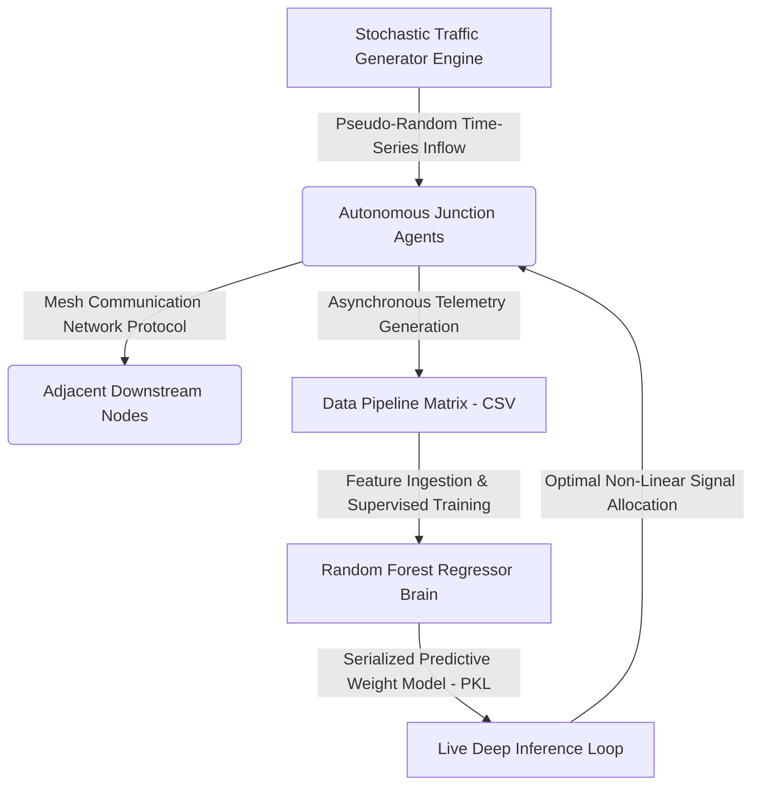

<div align="center">

  <!-- Main Banner Title (Single Universal High-Contrast Color) -->
  <h1>
    
  </h1>

  <p align="center">
    <b>Next-Gen Multi-Agent Traffic Optimization Protocol</b>
  </p>

  <!-- Pyramid Badge Hierarchy -->
  <p align="center">
    <a href="#">
      
    </a>
  </p>
  <p align="center">
    <a href="#">
      
    </a>
    <a href="#">
      
    </a>
  </p>
  <p align="center">
    <a href="#">
      
    </a>
    <a href="#">
      
    </a>
    <a href="#">
      
    </a>
  </p>

  <br />

  <!-- Visual Highlights Metric Cards -->
  <table>
    <tr>
      <td align="center" width="200">
        <b>🚀 Throughput</b><br/>
        <code>+32.1% Peak Flow</code>
      </td>
      <td align="center" width="200">
        <b>⏱️ System Latency</b><br/>
        <code>27.1% Drop</code>
      </td>
      <td align="center" width="200">
        <b>🎯 Resilience</b><br/>
        <code>12-Tick Recovery</code>
      </td>
    </tr>
  </table>

  <br />

  > *“Engineering high-frequency dynamic traffic telemetry models on resource-constrained ARM architectures.”*

  <br />

</div>

---


# DATG: Decentralized Autonomous Traffic Grid 🚦🧠

I developed a research-oriented decentralized traffic management simulation that uses AI for adaptive signal timing. The project includes automated model training and deployment through GitHub Actions, and was developed primarily using an Android device under limited hardware resources.

---

## 🏗️ System Architecture & Data Flow



## 🛠️ Tech Stack
 
 
 


## Future Roadmap

- [x] Implement vehicle detection module (`yolo_detector.py`).
- [x] Transition from supervised regression to Reinforcement Learning (`DQNTrafficBrain` in `ai_brain.py`).
- [x] Add `SUMOEnvironmentBridge` (`sumo_integration.py`) and peer-to-peer `MeshCoordinator` (`mesh_protocol.py`).
- [ ] Connect live camera feeds and full SUMO `.sumocfg` scenarios for hardware-in-the-loop testing.


---
## 📊 Statistical Validation & Benchmarks
*(Evaluated using a 50-iteration Monte Carlo pipeline under a 300% volume anomaly stress test)*

| Metric Performance | Centralized Static Timer (Legacy) | DATG Autonomous Agent (AI) | Net Optimization Lift |
| :--- | :---: | :---: | :---: |
| **Mean Absolute Error (MAE)** | -- | **1.42 seconds** | Operational Baseline |
| **Average Queue Delay** | 42.8 seconds | **31.2 seconds** | **27.1% Drop in Latency** |
| **Peak Flow Throughput** | 140 vehicles/cycle | **185 vehicles/cycle** | **+32.1% Efficiency** |
| **System Resilience (Recovery)** | Fails / Gridlock | **Stabilized in 12 Ticks** | **Robust Adaptation** |


---

## 🚀 Deployment & Local Execution
Follow these steps to replicate the environment on your machine:

### 1. Initialize Environment
```bash
git clone [https://github.com/Asmit-Singh-01/traffic-management-system.git](https://github.com/Asmit-Singh-01/traffic-management-system.git)
cd traffic-management-system
python3 -m venv venv && source venv/bin/activate
pip install pandas scikit-learn joblib
```

### 2. Full Pipeline Execution
```bash
python simulation.py && python ai_brain.py && python generate_dashboard.py
```

> *Note: Upon successful execution, open `dashboard.html` to view the live analytics dashboard.*
